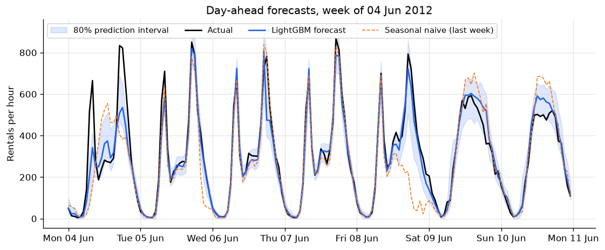
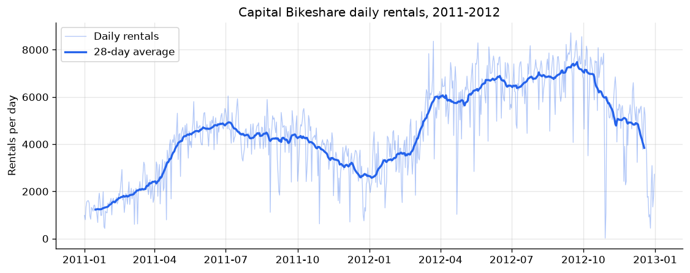
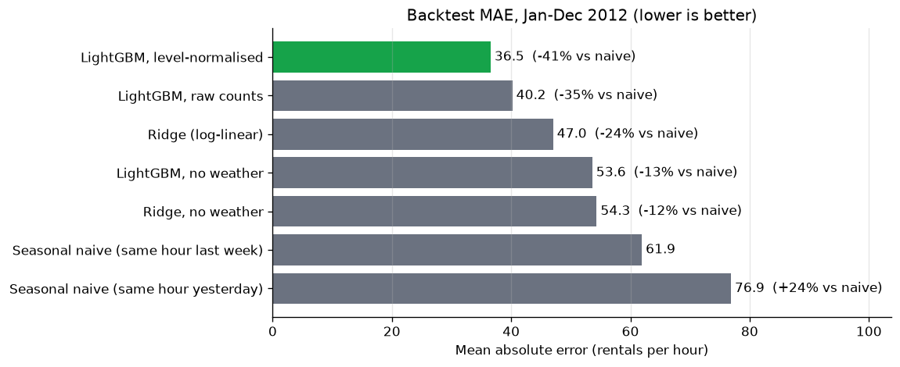
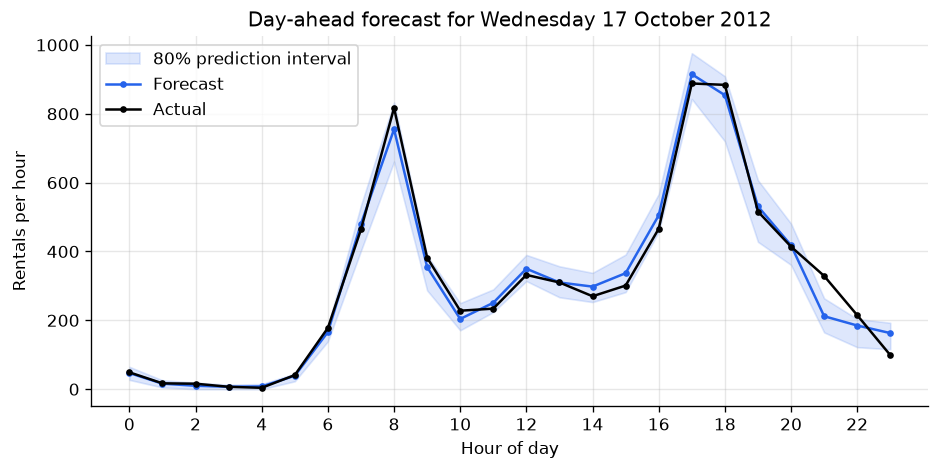
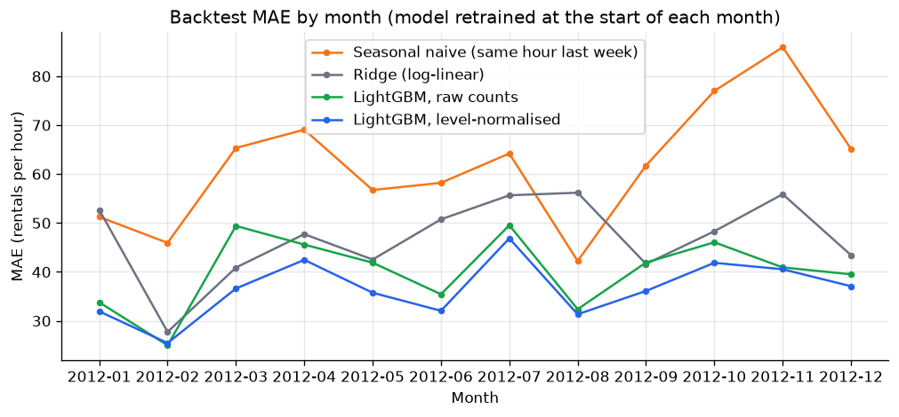
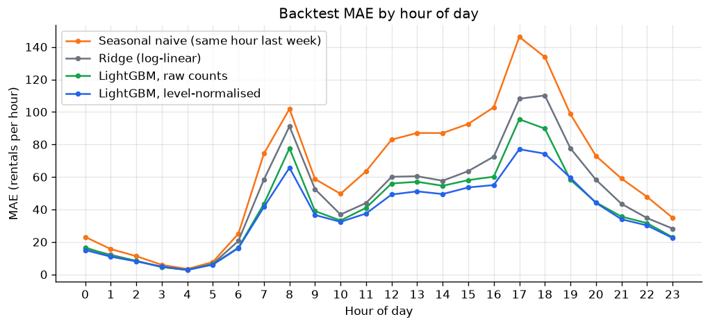
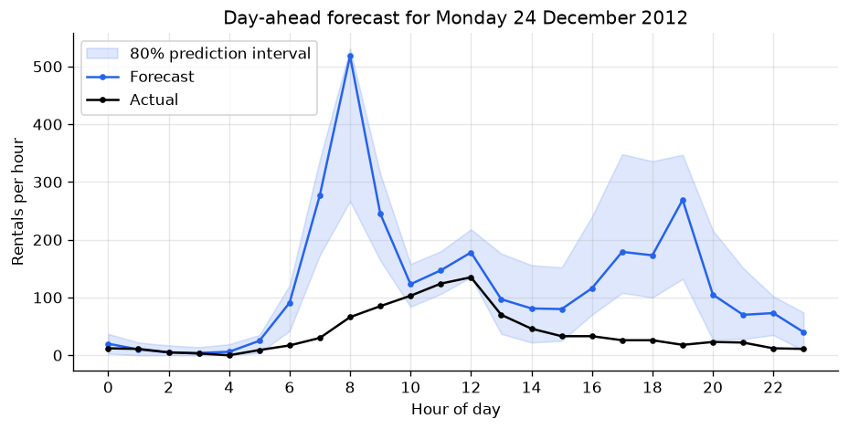

# Bike-Sharing Demand Forecasting

[](https://github.com/fareszid/bike-demand-forecasting/actions/workflows/ci.yml)

[](LICENSE)

Every night at midnight, forecast how many bikes will be rented in each hour of the next day,
with an 80% prediction interval, so the operations team can plan bike rebalancing and staffing.

**Result:** over a full year of rolling-origin backtesting (8,784 hourly forecasts in 2012), the
LightGBM model cuts the error of the seasonal-naive baseline by **41%** (MAE 36.6 vs. 61.9
rentals per hour), forecasts daily totals within **9.9%**, and its calibrated 80% intervals
contain the actual value **79.9%** of the time.



## The setup

| | |
|---|---|
| Decision | How many bikes to move to which stations, how many staff per shift |
| Forecast made | Every day at 00:00 |
| Horizon | The 24 hours of that day (1 to 24 hours ahead) |
| Inputs | Demand up to the previous midnight, calendar, weather (see the caveat below) |
| Metrics | MAE and WAPE per hour, WAPE of daily totals, interval coverage |

The horizon drives the feature design: no feature may use demand from less than 24 hours before
the hour being predicted. A test changes future demand and checks that no feature moves
([`tests/test_features.py`](tests/test_features.py)).

## What the data shows

Full analysis in [`notebooks/01_exploratory_analysis.ipynb`](notebooks/01_exploratory_analysis.ipynb).

- Demand grew **65%** in one year (1.24M to 2.05M rentals), on top of a strong seasonal cycle.
- Two regimes: commuter peaks at 8 am and 5-6 pm on working days, one leisure hump on weekends.
- Autocorrelation peaks at 24 h (0.82) and 168 h (0.87): the same hour last week tells more
  than the same hour yesterday.
- Light rain or snow halves demand; demand rises with temperature up to about 30 °C.
- 165 hours are missing from the raw file: empty night hours and real shutdowns (Hurricanes
  Irene in 2011 and Sandy in 2012). They are filled with 0 and flagged.



## Method

**Features**, all known at forecast time: hour, day of week, month, holiday and working-day
flags, weather, demand lags of 24/48/168/336 hours, the same-hour mean of the last 7 days, the
previous day's total and the 7-day average level.

**Models:**

| Model | Idea |
|---|---|
| Seasonal naive | Same hour last week (or yesterday). The baseline to beat. |
| Ridge | One-hot hour × working-day effects, Fourier terms, weather and log lags, trained on `log1p(demand)` |
| LightGBM, raw counts | Gradient boosting with a Poisson objective on raw demand |
| **LightGBM, level-normalised** | Same model, but it predicts demand divided by the 7-day level, then scales back |

**Why normalise by the level?** Tree models can only predict values they have seen in training.
With demand growing 65% a year, a tree trained on raw counts keeps under-forecasting new highs.
Predicting the ratio to the recent level gives a target that is stable over time. It cut MAE by
9% and the systematic bias by a third compared with the raw-count model.

**Prediction intervals.** LightGBM quantile models (10th and 90th percentiles) on their own were
over-confident: their 80% interval contained the actual value only 63% of the time. I added
split-conformal calibration (CQR): measure how far the actuals fall outside the interval over
the last 28 days of training, and widen the interval by that margin. Coverage went to 79.9%.

**Backtest.** For each month of 2012, every model is retrained on all earlier data and then
predicts the month. All demand features are lagged by at least 24 hours, so this gives the same
numbers as a fresh forecast every night. Random K-fold would leak future data, so it isn't used.

## Results

Hourly accuracy, January to December 2012 (8,784 hours):

| Model | MAE | RMSE | WAPE | Bias | Daily-total WAPE |
|---|---|---|---|---|---|
| **LightGBM, level-normalised** | **36.6** | **58.8** | **15.7%** | -3.0% | **9.9%** |
| LightGBM, raw counts | 40.2 | 65.9 | 17.2% | -4.5% | 10.8% |
| Ridge | 47.0 | 74.3 | 20.2% | -9.2% | 15.0% |
| LightGBM, no weather | 53.6 | 87.2 | 23.0% | -7.0% | 17.8% |
| Ridge, no weather | 54.3 | 85.9 | 23.3% | -9.2% | 18.9% |
| Seasonal naive (same hour last week) | 61.9 | 107.6 | 26.5% | 0.0% | 19.8% |
| Seasonal naive (same hour yesterday) | 76.9 | 128.8 | 32.9% | 0.0% | 15.5% |

<table>
<tr>
<td></td>
<td></td>
</tr>
<tr>
<td></td>
<td></td>
</tr>
</table>

The level-normalised LightGBM is the best model in every month of 2012 except February (where
the raw-count model is 0.5 better), and at 21 of 24 hours of the day (at 3-4 am and 7 pm it is
within about 1 rental per hour of the best). Most of the remaining error is in the commuting
peaks, where a few hundred bikes can appear or vanish with the weather.

**Weather caveat.** Without weather features, the MAE goes from 36.6 to 53.6. The backtest uses
*observed* weather, which in production would only be known as a forecast, so real accuracy
would be somewhere between those two numbers. Still well ahead of the baseline.

**Feature importance.** By split gain, the demand features (`same_hour_mean_7d`, `lag_336`,
`lag_168`) and `hour` dominate and weather looks unimportant, yet removing weather costs +47%
MAE. Gain importance and actual predictive value are different things; the ablation is the
better test.

## Error analysis

The biggest daily errors are days the history can't predict:

| Day | Actual | Forecast | What happened |
|---|---|---|---|
| Sat 17 Mar 2012 | 7,836 | 5,147 | Warm St. Patrick's Day, busiest weekend day so far |
| Sun 8 Apr 2012 | 5,169 | 7,831 | Easter Sunday |
| Mon 29 Oct 2012 | 22 | 2,242 | Hurricane Sandy, system shut down |
| Thu 22 Nov 2012 | 2,425 | 4,504 | Thanksgiving |
| Mon 24 Dec 2012 | 920 | 2,796 | Christmas Eve |

Christmas Eve counts as a working day in the data (it isn't a federal holiday), so the model
expects commuters who never come. Even retrained on data up to 23 December
(`bikeforecast forecast --date 2012-12-24`) it forecasts 2,932 rentals:



A production system would need a calendar of special days (holiday eves, school holidays, local
events) and a way for planners to override forecasts for known disruptions.

## Run it

```bash
git clone https://github.com/fareszid/bike-demand-forecasting.git
cd bike-demand-forecasting
python -m venv .venv && source .venv/bin/activate
make install                                # pip install -e ".[dev]"
make backtest                               # ~1 minute, writes reports/metrics.json + figures
bikeforecast forecast --date 2012-10-17     # one day-ahead forecast with intervals
make test                                   # 20 tests, offline, ~2 seconds
```

The dataset (280 KB) is downloaded on first use.

## Project structure

```
├── src/bikeforecast/
│   ├── data.py        # download, unit conversion, gap filling
│   ├── features.py    # calendar, Fourier and lag features
│   ├── models.py      # seasonal naive, Ridge, LightGBM (+ conformal intervals)
│   ├── backtest.py    # rolling-origin evaluation
│   ├── metrics.py     # MAE, RMSE, WAPE, bias, coverage
│   ├── plots.py       # report figures
│   └── cli.py         # bikeforecast backtest / forecast
├── tests/             # leakage, data, model and backtest tests on synthetic data
├── notebooks/         # EDA notebook
└── reports/           # metrics.json, backtest predictions, figures
```

## Limitations and next steps

- Use historical weather *forecasts* instead of observations (the Open-Meteo archive has them)
  to measure the real production accuracy.
- Add a special-days calendar: holiday eves, school holidays, events.
- Forecast per station. Rebalancing happens per station, and a hierarchical model with
  reconciliation would keep station forecasts consistent with the city total.
- Model casual and registered riders separately, since they behave very differently.

## Data

[UCI Bike Sharing Dataset](https://archive.ics.uci.edu/dataset/275/bike+sharing+dataset)
(Fanaee-T & Gama, 2013), Capital Bikeshare, Washington D.C., licensed CC BY 4.0. Downloaded at
runtime, not stored in this repository.
